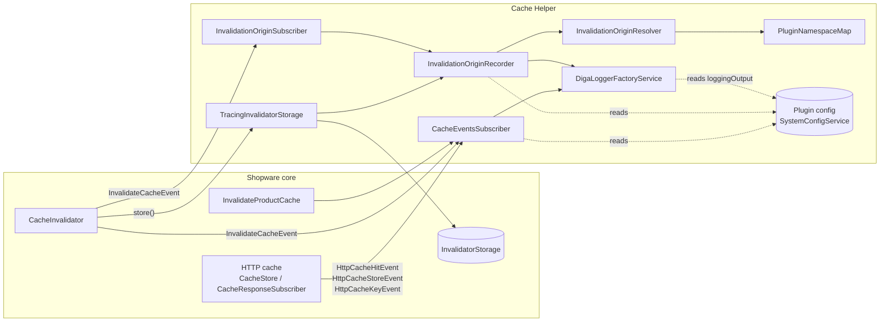

# Architecture

The plugin only observes. It subscribes to Shopware's cache events, decorates one storage service, and writes log lines. It never changes what is cached or invalidated.

All services are wired in `src/Resources/config/services.xml`; the plugin class `DigaShopwareCacheHelper` adds nothing beyond the Shopware default.

## Components

| Class | Role |
| --- | --- |
| `Subscriber\CacheEventsSubscriber` | Subscribes to `HttpCacheHitEvent`, `HttpCacheStoreEvent`, `HttpCacheKeyEvent`, `InvalidateCacheEvent` and `InvalidateProductCache`. Each handler checks its own setting and writes one line. Everything is wrapped in `try/catch`, so a logging error never breaks a request. |
| `Service\DigaLoggerFactoryService` | Logger proxy. Depending on `loggingOutput`, it forwards to Shopware's `monolog.logger` or to its own `RotatingFileHandler` (`var/log/diga_cache_helper-<env>.log`). Log methods are forwarded via `__call`, so it does not implement `LoggerInterface`. |
| `Invalidation\TracingInvalidatorStorage` | Decorator for `AbstractInvalidatorStorage`. Records deferred invalidations after the inner `store()` succeeded. |
| `Subscriber\InvalidationOriginSubscriber` | Records immediate invalidations from `InvalidateCacheEvent`, sets the CLI/worker context, and flushes the recorder at the end of each request, command or message. |
| `Invalidation\InvalidationOriginRecorder` | Buffers and merges origins per request/command/message and writes them on flush. Reads its settings once per cycle. Tagged `kernel.reset`. |
| `Invalidation\InvalidationOriginResolver` | Finds trigger, plugin and caller in `debug_backtrace()`, anchored on `CacheInvalidator::invalidate`. |
| `Invalidation\PluginNamespaceMap` | Maps a class to the active plugin whose namespace contains it (longest prefix wins). |
| `Invalidation\InvalidationOrigin` | Value object with the result of the resolver. |

Details of the invalidation origin flow: [Invalidation origin > How it works](invalidation-origin.md#how-it-works).

## Design decisions

- **Why not decorate `CacheInvalidator`?** It would be the obvious single hook, but the class is `@final` by docblock and core services type-hint the concrete class, so a decorator would have to extend it. PHPStan rejects that (`class.extendsFinalByPhpDoc`), and it would break on internal changes. The storage decorator plus the event listener cover the same paths using extension points Shopware intends to be used.
- **Why a namespace map instead of file paths?** Plugins installed via Composer live in `vendor/`, so their file paths look like any other dependency. The namespace of the plugin base class identifies them wherever they are installed.
- **Why buffer and flush at the end?** Imports call `invalidate()` hundreds of times per request. Merging gives one readable line per origin, and writing after the response keeps file I/O out of the response time.
- **Why is the logger a `service_closure`?** The recorder is created whenever the storage or the subscriber is, which happens in most processes. The logger (and the config read in its constructor) is only needed when there is something to write.

## Shopware version notes

- `HttpCacheKeyEvent` handling has two paths. The 6.6+ path (`Feature::isActive('v6.6.0.0')`) hashes `getParts()`. The legacy path rebuilds the key from the hash and cookies and is not used on 6.7.
- `CacheInvalidator` changed within 6.7 (6.7.0 vs. 6.7.14: delay switch, soft purge, own purge log, fallback to immediate purge when storing fails). The plugin relies only on `AbstractInvalidatorStorage::store()`, `InvalidateCacheEvent`, and the method names `invalidate` / `invalidateExpired` in the stack. Check these on Shopware updates.
- Earlier majors of the plugin were mostly adaptations to renamed or removed core cache APIs: 3.0.0 for 6.6 dropped the HTTP cache warmup command, 4.0.x adapted to 6.7.
