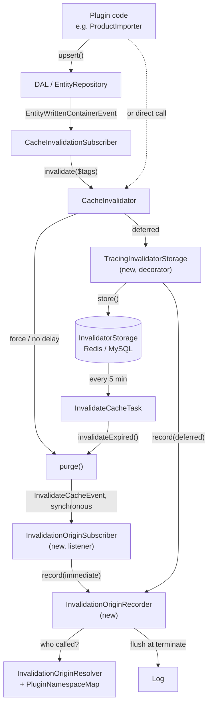

# Invalidation origin

Tells you which plugin caused a cache invalidation, which code triggered it, and in which request, command or worker message it happened. Use it when caches are cleared more often than expected, or when a hit rate drops after installing or updating a plugin.

Off by default. Enable it with *Log invalidation origin* (`logInvalidationOrigin`).

## Why the regular invalidation log is not enough

`InvalidateCacheEvent` shows *what* was purged, not *who* asked for it, for two reasons:

- **Delayed invalidation.** Without `force`, Shopware only stores the tags (Redis or MySQL). The scheduled task `InvalidateCacheTask` purges them every 5 minutes, and the purge then runs in the task. The request that caused it is long gone.
- **Indirect calls.** Plugins rarely call `CacheInvalidator::invalidate()` themselves. They write entities through the DAL, and Shopware's `CacheInvalidationSubscriber` reacts to `EntityWrittenContainerEvent`. The plugin is several levels down the call stack.

Shopware 6.7.x has its own optional purge log (`shopware.cache.invalidation.tag_invalidation_log_enabled`). It only shows the direct caller at purge time, which on the delayed path is the scheduled task.

## Log line

One line per origin and per request, command or worker message. Repeated calls with the same origin are merged and counted.

```
InvalidationOrigin | <context> | <plugin> | mode: <mode> | calls: <n> | tags: <n> [(first <n>)] [<tags>] | trigger: <Class::method> [| caller: <Class::method> (<file>:<line>)] [| stack: <Class::method> < …]
```

| Field | Meaning |
| --- | --- |
| context | `GET /path` (or the full URL with `logFullUri`) for HTTP, `cli: <command>` for the console, `worker: <message class>` for messenger workers, `unknown` if none of these applies |
| plugin | Name of the first active plugin found in the call stack, or `core` if no plugin is involved |
| mode | `immediate`: purged right away (force, `sw-force-cache-invalidate: 1` header, delay disabled, or storing the tags failed). `deferred`: stored and purged later by the scheduled task |
| calls | How many `invalidate()` calls were merged into this line |
| tags | Total number of tags over all merged calls, followed by the list. `(first n)` means the list was cut at *Max tags per invalidation origin entry* |
| trigger | The method that called `CacheInvalidator::invalidate()`, i.e. where the invalidation was triggered |
| caller | The plugin method responsible, with file and line of the call inside it. Only present when a plugin was found |
| stack | All plugin methods in the call stack, innermost first. Only with *Log plugin call stack* enabled |

### Examples

A plugin imports products from the console. Its writes go through the DAL, and Shopware's subscriber invalidates:

```
InvalidationOrigin | cli: erp:import | ErpSync | mode: deferred | calls: 412 | tags: 824 (first 20) ["product-019808…","product-listing-route-…",…] | trigger: Shopware\Core\Framework\Adapter\Cache\CacheInvalidationSubscriber::invalidateManufacturerFilters | caller: ErpSync\Service\ProductImporter::importBatch (ProductImporter.php:88)
```

A config value was saved, no plugin involved (real output from Shopware 6.7.0.1):

```
InvalidationOrigin | cli: system:config:set | core | mode: immediate | calls: 1 | tags: 1 ["system-config"] | trigger: Shopware\Core\Framework\Adapter\Cache\CacheInvalidationSubscriber::invalidateConfigKey
InvalidationOrigin | cli: system:config:set | core | mode: deferred | calls: 1 | tags: 1 ["system.config-019808e945cc715099a982ff237aa9b8"] | trigger: Shopware\Core\Framework\Adapter\Cache\CacheInvalidationSubscriber::invalidateConfigKey
```

### Matching deferred origins with the later purge

A `deferred` line is written when the tags are stored. Minutes later the scheduled task purges them, and that shows up as a normal `InvalidateCacheEvent` line. The task merges the tags of many requests, so a purge cannot be traced back to exactly one origin. Match them by tag instead:

```bash
grep -F 'product-019808ebb4b3' var/log/diga_cache_helper-prod-*.log
```

The scheduled purge itself does not produce an `InvalidationOrigin` line, because its origin was already logged when the tags were stored.

## How it works



The plugin hooks in at two officially extendable points. Both run while `CacheInvalidator::invalidate()` is still on the call stack:

1. **Deferred path.** `TracingInvalidatorStorage` decorates `AbstractInvalidatorStorage`. After the inner `store()` succeeded, it records the origin as `deferred`. If storing fails, Shopware 6.7.x purges immediately and step 2 records it as `immediate`.
2. **Immediate path.** `InvalidationOriginSubscriber` listens to `InvalidateCacheEvent`. Shopware dispatches it synchronously inside `purge()`, so the caller is still on the stack.

`InvalidationOriginResolver` then reads the stack with `debug_backtrace(DEBUG_BACKTRACE_IGNORE_ARGS, 50)`:

1. It looks for the frame `CacheInvalidator::invalidate` as the anchor. If it finds `CacheInvalidator::invalidateExpired` first, this is the scheduled purge of deferred tags, and nothing is recorded.
2. The first frame above the anchor, outside this plugin, is the **trigger**.
3. It walks further out until a class belongs to an active plugin. That is the **plugin**, and the method is the **caller**. File and line come from the frame below it (the call site inside the caller).

`PluginNamespaceMap` decides which plugin a class belongs to. It takes the namespace of each active plugin's base class from `KernelPluginCollection`, e.g. `Swag\PayPal\` for `Swag\PayPal\SwagPayPal`, and the longest matching prefix wins. That works for plugins in `custom/plugins` as well as for plugins installed via Composer in `vendor/`. Frames of the Cache Helper itself are skipped.

`InvalidationOriginRecorder` merges the results in memory and writes them at the end:

| Process | Context set by | Flushed on |
| --- | --- | --- |
| HTTP request | main request, remembered on `kernel.request` (original SEO url) | `kernel.terminate` (after the response was sent) |
| HTTP cache hit | request of `HttpCacheHitEvent`, marked `(cache hit)` | shutdown function (Symfony skips `kernel.terminate` for cache hits) |
| Console command | `console.command` | `console.terminate` |
| Messenger worker | `WorkerMessageReceivedEvent` | `WorkerMessageHandledEvent`, `WorkerMessageFailedEvent` |

It also flushes when 200 different origins are buffered, on `kernel.reset`, and in a shutdown function as safety net, which is registered on the first buffered origin. That covers processes that end without any of the events above, most notably a cache hit: the kernel does not run, so there is no `kernel.terminate`, and PHP-FPM never calls `kernel.reset`.

## Performance

The storefront hot path (cache hit, cache write) is not touched. `invalidate()` only runs on writes, imports, indexing and admin actions.

| Situation | Cost | Why it stays small |
| --- | --- | --- |
| Feature off | One boolean check per stored or purged tag set | Settings are read once per request or message, not on every call |
| Feature on, per call | One `debug_backtrace()` without arguments, up to 50 frames | No arguments are copied; the search stops at the first plugin frame unless the stack option is on |
| Plugin lookup | Prefix match against the active plugins | The map is built once per process, results are memoized per class |
| Bulk imports | Hundreds of calls per request | Merged in memory into one line per origin, tag list capped |
| Writing the log | File I/O | Once at the end, after the response was sent; the logger is only created when there is something to write |

## Limits

- **Asynchronous indexing.** If a plugin writes data in a request but indexing runs in the message queue, the invalidation happens in the worker. The line then shows `worker: <message class>` and usually `core`, not the plugin that wrote the data.
- **Apps and API integrations** have no PHP code in the shop. They show up as `core`, with the API route as context.
- **Bypassing the invalidator.** Calls that go straight to a cache pool (`cache.object->invalidateTags()`) or `cache:clear` are not seen.
- **Merged purges.** A deferred origin cannot be linked 1:1 to the later purge; match by tag, see above.

## Troubleshooting

| Symptom | Check |
| --- | --- |
| No `InvalidationOrigin` lines | Is `logInvalidationOrigin` enabled? Did anything invalidate at all (`InvalidateCacheEvent` lines, or `bin/console cache:clear:delayed`)? |
| Always `core` although a plugin wrote the data | Indexing probably runs asynchronously; look for a `worker:` context. Enable *Log plugin call stack* to see all plugin frames. |
| Worker context missing or settings not applied | Restart `messenger:consume` after changing the config. |
